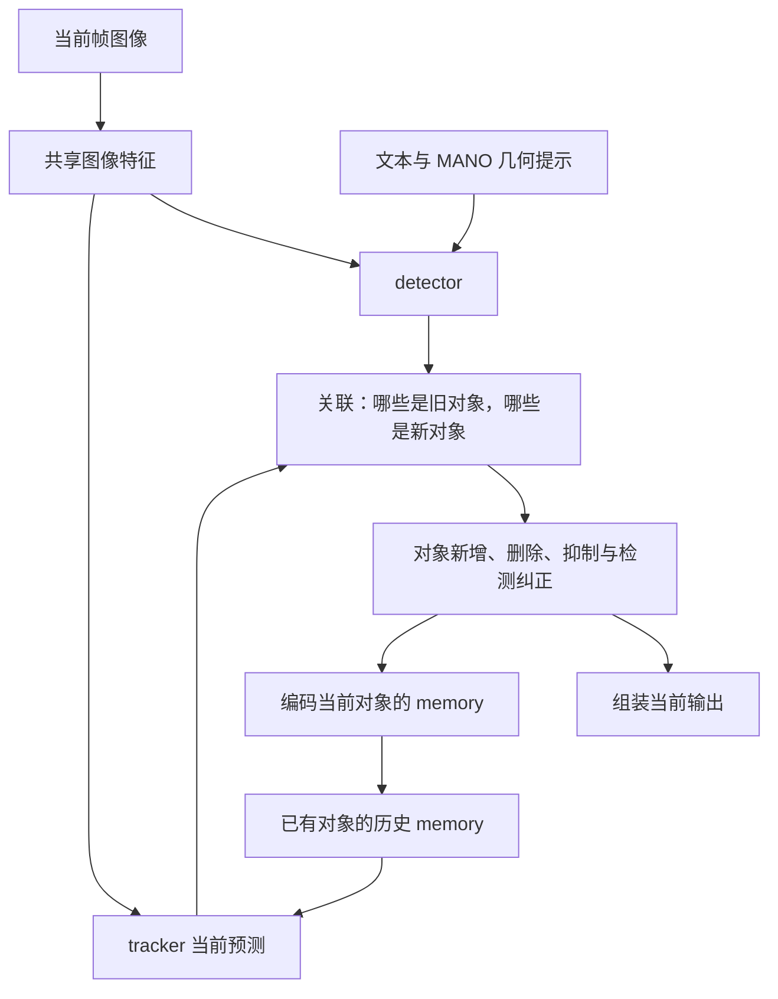
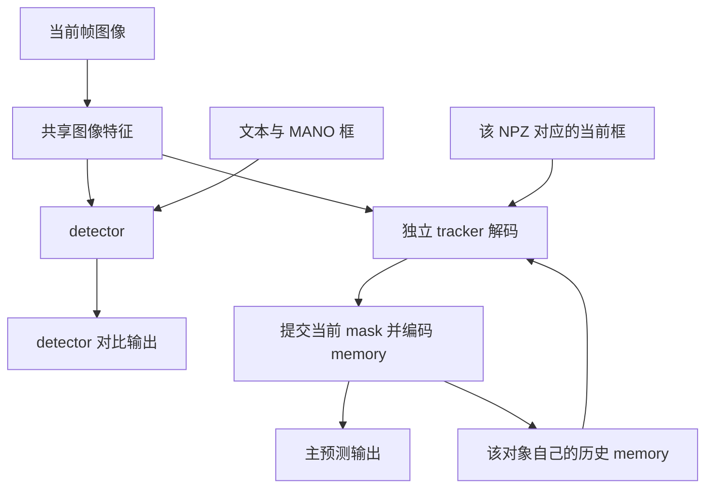

# SAM 3 的 detector、tracker 与 memory：代码流程、实验分析和修改建议

本文以本仓库提交 `1166e10ee38e6f615512bc3ac5d3a3b911cefa2a` 为准，讨论基础 SAM 3，不讨论 SAM 3.1 multiplex。检查日期：2026-09-21。本文只记录分析和方案，没有修改推理代码，也没有重新运行 GPU 推理。

先给结论：当前 box2tracker 实验总体优于旧视频融合结果，但仍显著低于 detector。新提交让 detector 和独立 tracker 分别预测，detector 的正确掩码没有进入 tracker 的初始化、纠正或 memory。因此，最值得试的是让可靠的 detector 掩码重新成为 tracker 的语义约束，并控制哪些预测可以写入和读出 memory。旧融合路径的两处一致性问题仍值得修，但它们没有在新独立 tracker 路径中执行，不能解释这次实验的全部问题。

## 1. 阅读范围与证据

对比的两个输出目录为：

- A，未给 tracker 框：[right_hand_box_from_masks_sam3](../outputs/mano_prompt/realsense_hand_object_with_seg_to_wjh/right_hand_box_from_masks_sam3/gt_summary.json)。
- B，独立 box tracker：[right_hand_box_from_masks_sam3_with_box2tracker](../outputs/mano_prompt/realsense_hand_object_with_seg_to_wjh/right_hand_box_from_masks_sam3_with_box2tracker/gt_summary.json)。

证据包括这两个目录的 `metadata.json`、`gt_metrics.csv/json`、`gt_summary.json`，若干帧的 `comparison.mp4`、无损预测/GT 掩码，以及当前源代码。文中“代码事实”“观察结果”和“待验证解释”分别标明，避免把合理猜测写成已证实因果。

SAM 3 的总体设计是共享图像 backbone 的图像 detector 与 memory tracker；SAM 2 的视频能力建立在流式 memory 上。这两点分别可查 [SAM 3 论文](https://arxiv.org/abs/2511.16719) 和 [SAM 2 论文](https://arxiv.org/abs/2408.00714)。本文中的具体阈值、分支和状态行为均以本仓库代码为依据，不能直接当作所有上游版本的行为。

## 2. 先分清三条运行路径

| 路径 | 当前主输出来自哪里 | detector 掩码是否影响 tracker | 是否读写 tracker memory |
|---|---|---|---|
| 原视频融合路径 `_det_track_one_frame` | 已有对象通常用 tracker，新对象用 detector，特定条件下纠正 | 会用于建对象和受条件限制的纠正 | 是 |
| `1166e10` 独立 MANO tracker 路径 | 每个 MANO NPZ 对应的独立 tracker | 不会；detector 结果只作为并行结果返回 | 是，来自 tracker 自己的预测 |
| `--detector-only` | 当前帧 detector 掩码并集 | 不运行 tracker | 否 |

`1166e10` 的变化不只是“在原流程里再传一个 box”。它同时改变了初始化、身份分配、检测关联、纠正和对象生命周期。两组视频可以比较整体效果，但不是严格的“只有 tracker 是否接收框不同”的单变量实验。

当前 MANO 脚本会按 NPZ 文件名排序分配固定对象 ID，并将逐帧框传入 `tracker_box_prompts`。模型检测到 `per_frame_tracker_boxes` 后进入独立路径，不再调用原来的 `_det_track_one_frame`。定位见 [MANO 脚本](../scripts/process_mano_prompt_videos.py) 的 `load_geometries`、`main`，以及 [视频推理](../sam3/model/sam3_video_inference.py) 的 `_run_single_frame_inference`、`_run_independent_tracker_frame`。

## 3. 用通俗方式理解各部分

可以把 detector 看作“拿着任务说明，每帧重新看图的人”，把 tracker 看作“拿着对象档案，继续追同一个对象的人”。memory 是对象档案，但档案里的内容也可能来自之前的错误判断。

| 名称 | 通俗含义 | 代码中的形态 |
|---|---|---|
| detector | 根据当前图像、文字和几何提示找目标 | `det_out['mask'/'bbox'/'scores']` |
| tracker | 根据当前图像、对象历史和可选点/框提示重新画轮廓 | `pred_masks`、`object_score_logits` |
| mask logits | 每个像素偏向前景还是背景的实数分数 | 通常以 `> 0` 变成二值掩码 |
| 空间 memory | 某帧中“这个对象长什么样、在哪些位置”的特征图 | `maskmem_features`、`maskmem_pos_enc` |
| object pointer | 对象的一段紧凑特征描述，不是 Python 指针 | `obj_ptr` |
| 条件帧 cond | 该帧接收过点、框或 mask 提示 | `cond_frame_outputs` |
| 普通传播帧 non-cond | 主要依赖历史传播得到的帧 | `non_cond_frame_outputs` |

“条件帧”只表示它接受了提示，不表示该帧预测一定正确。特别是输入 box 时，框内究竟哪些像素属于手，仍然要由 tracker 猜出来。

## 4. 原视频路径怎样组合 detector 和 tracker

### 4.1 它并不是逐像素平均两个答案

原路径的主要组合发生在“对象管理”和“何时采纳检测纠正”这两层，而不是每帧做 `0.5 × detector + 0.5 × tracker`。



一个帧步骤的实际顺序如下，入口是 [sam3_video_base.py](../sam3/model/sam3_video_base.py) 的 `_det_track_one_frame`：

1. **运行 detector。** 文本特征可以缓存复用，当前图像特征重新计算；当前帧的 MANO 几何进入 detector。检测结果经过 NMS 和检测分数筛选。同时准备 tracker 需要的图像特征。
2. **传播已有 tracker。** tracker 使用先前 memory 预测当前 mask；这一阶段暂不编码当前帧的新 memory，避免还没完成决策就写入历史。
3. **关联和规划。** 对比检测 mask 与 tracker mask 的重合程度，确定新对象、匹配对象、失配对象和纠正候选；执行热启动、遮挡等策略。当前代码实际上也在这个规划函数内部编码已有对象的 memory。
4. **执行对象新增/删除。** 新检测以 mask 提示建立 tracker 状态。已有对象通常保留其轨迹身份。
5. **组装输出。** `build_outputs` 默认取已有对象的 tracker mask，再加入新检测 mask；被明确标记为纠正的对象可以改用 detector mask。之后 `_postprocess_output` 隐藏被抑制/删除的对象，并处理实例重叠。

所以 detector 每帧预测正确，也不保证最终已有对象的轮廓自动被替换成它的答案。

### 4.2 默认规则与纠正空档

以下是当前基础 SAM 3 默认构造和原融合路径的参数，不适用于独立 box tracker 的关联逻辑，因为它没有运行这段关联。

| 规则 | 默认条件 | 实际意义 |
|---|---|---|
| 检测保留 | 分数 `> 0.5` | 进入 `det_out` |
| 检测 NMS | 阈值 `0.1` | 抑制重复检测 |
| 检测是否对应旧对象 | mask IoU `>= 0.1` | 达标则阻止把该检测当新对象加入 |
| tracker 是否被检测匹配 | mask IoU `>= 0.5` | 用于失配和生命周期判断，是另一道门槛 |
| 创建新对象 | 通常要求检测分数 `>= 0.7` 且不匹配旧对象 | 尚无任何 tracker 时，代码会把保留的检测直接视为新对象，存在初始化例外 |
| 检测纠正候选 | 检测分数 `>= 0.8`、mask IoU `>= 0.8`、匹配不歧义 | 只有少数检测能进入纠正候选 |
| 周期纠正 | 原始帧号可被 16 整除 | 不是每个对象从出现起每数 16 帧；仍需通过候选和 tracker 分数条件 |

`_recondition_masklets` 还比较 `tracker_obj_scores_global > 0.8`。这里传入的是对象存在 **logit**，不是已经 sigmoid 的概率；不能把这个条件描述为“tracker 概率必须超过 80%”。它也不是边界准确率。

假设 detector 的手掩码为 100 像素，tracker 的手加前臂为 250 像素，前者完全包含在后者中，两者 IoU 为 0.4。正确检测既会因超过 0.1 而被阻止新建对象，又因低于 0.8 而不能纠正旧对象。这解释了原路径的一个恢复障碍。其他生命周期规则仍可能删除后重建对象，不能据此断言整个系统永远不会恢复。

关联用的是 detector 与 tracker 之间的 IoU，不是与 GT 的 IoU。这里 GT 不参与推理。

关联中的生命周期匹配 `im_mask` 使用去歧义前的重合矩阵，供热启动累计同一检测匹配多条轨迹的重复证据；只有重条件化候选使用去歧义后的矩阵。这样不会因禁止歧义纠正而同时抹掉去重证据。该逻辑由基础 SAM 3 和 SAM 3.1 multiplex 共用，去重阈值和 hotstart 时间窗口未改变；已有导出的掩码不会自动修复，需要重新推理才能应用。

## 5. memory 到底存什么，怎样产生和使用

### 5.1 memory 不是原封不动存一张二值图

核心流程可以概括为：

```text
当前帧图像特征 + 本帧采纳的对象 mask
                    ↓ memory encoder
        空间 memory 特征 + 空间位置编码

本帧 mask decoder 的对象描述 → object pointer
上述内容连同 mask、对象存在分数等写入对象状态
```

在当前基础模型中，输入侧长为 1008，backbone stride 为 14，顶层特征网格为 72×72；tracker 低分辨率 mask 为 288×288。memory encoder 输出的空间特征通道数为 64；object pointer 的原始描述维度为 256，读入 memory attention 时可拆成多个 64 维 token。尺寸与配置来自 [model_builder.py](../sam3/model_builder.py) 的 `build_tracker`、`_create_tracker_maskmem_backbone`，以及 [sam3_tracker_base.py](../sam3/model/sam3_tracker_base.py) 的初始化和 `_prepare_memory_conditioned_features`。

这意味着错误 mask 不只是影响当前画面：如果把衣服标成目标，再用这张 mask 和当前图像特征编码，历史里会留下与衣服区域关联的对象信息。未来读到它时，可能继续强化错误。这是机制上的可能性，是否是某个具体失败片段的主因还需消融确认。

### 5.2 写 memory 的处理细节

`_encode_new_memory` 的主要步骤：

1. 取得当前帧的视觉特征。
2. 将 mask logits 转成供 memory encoder 使用的 mask。普通传播一般使用 sigmoid；推理时的点/框条件路径通过 `is_mask_from_pts=True` 使用 `logits > 0` 的二值结果。
3. 默认对 mask 数值做 `20 × mask − 10` 的缩放和平移，再通过 mask downsampler 与视觉特征融合。这是训练时约定的输入数值处理，不是一个可直接解释成“框权重 20”的参数。
4. 输出空间 memory 特征和位置编码。对象存在 logit 不大于 0 时，加入表示对象未出现的空间 embedding。
5. 将 memory、mask、object pointer 和对象分数等保存到当前帧的状态中，之后才能作为历史读取。

在交互或自动框路径中，`add_new_points_or_box` 先产生临时 mask；`propagate_in_video_preflight` 将临时结果合并到正式状态并编码 memory。它不是重新训练，而是一次推理状态提交。

对当前自动逐帧 box 来说，有一处值得注意：**box 只说明大致位置，但从 box 预测出来的轮廓会作为条件帧二值 mask 写入 memory。** 如果轮廓错了，它仍可能以明确前景的形式进入历史。

### 5.3 读 memory 的处理细节

`_prepare_memory_conditioned_features` 先选历史，再将当前图像特征对这些历史做 attention；随后 mask decoder 结合这些经过历史增强的图像特征以及当前点/框提示，生成新 mask。

读取包含两类信息：

- **空间 memory：** 历史图像中对象区域的空间特征，并带有空间、时间位置编码。
- **object pointer：** 历史对象的紧凑描述，也带时间信息。即使删掉一条错误空间 memory，如果对应错误 pointer 仍参与读取，污染也可能没有完全清除。

第一次初始化对象没有历史可读，代码使用 `no_mem_embed`。对已有对象，仅当 `is_init_cond_frame=False` 且 `use_prev_mem_frame=True` 时才走历史 attention。

当前传入 tracker 的图像特征来自共享 backbone，而不是 detector 的文本条件 mask decoder 输出。因此，“共享 backbone”不等于 tracker 已经获得了 `right hand` 的文本约束。

### 5.4 memory 有多少帧？不能只看一个参数

当前默认配置为：

| 配置 | 值 | 应如何理解 |
|---|---:|---|
| `num_maskmem` | 7 | 决定空间历史槽位等机制，不等于恰好只存或只看最近 7 张图片 |
| `max_cond_frames_in_attn` | 4 | 最多选择 4 个时间接近的条件帧 |
| `max_obj_ptrs_in_encoder` | 16 | 控制 pointer 历史检索范围；不保证每次实际读满 16 条 |
| `keep_first_cond_frame` | False | 第一张初始化帧不会永远被强制保留在读取集合中 |
| `use_memory_selection` | True | 默认启用模型分数驱动的普通传播帧筛选 |
| `mf_threshold` | 0.01 | 普通传播候选的内部质量门槛，不是 GT IoU 门槛 |

`frame_filter` 只检查 **non-cond** 中的 `eff_iou_score`。该分数近似为 `max(2 × sigmoid(对象存在 logit) − 1, 0) × 模型预测 IoU`，再按代码求均值；它衡量模型自身的估计，不能直接当作真实准确率。前一帧还会被强制加入候选。

条件帧的挑选走另一套逻辑：主要依据时间接近程度，不经过这道 non-cond 分数门槛。

一个具体例子：顺序处理第 10 帧，0～9 帧都加过框、都存为 cond，且没有 non-cond。默认配置下，空间 memory 和 pointers 实际选的是 9、8、7、6。`frame_filter` 找不到普通传播帧，只补入 9，而 9 已经在选中的条件帧中，不会再作为额外历史添加。关闭 `use_memory_selection` 才会出现不同的补充历史行为。这是对当前选择逻辑的静态计算，不是一次 GPU 注意力权重测量。

因此，**逐帧加框会让大量自动预测进入 cond，现有普通传播帧的质量筛选并不能替它们把关。** 最近连续几帧如果分错，很容易同时进入下一帧所读的条件历史。

## 6. `1166e10` 的独立 box tracker 实际做了什么



这里没有从 detector 掩码通往 tracker 的箭头，这是这次实现最关键的区别。

具体到 `_run_independent_tracker_frame`：

1. 每帧照常运行 detector，顺便准备 tracker 所需图像特征。
2. 每个 NPZ 对应一个固定 ID，首次遇到它的有效框时建立独立 tracker 状态。初始化的目标轮廓由 box tracker 预测，**不是拿 detector 的正确 mask 初始化**。
3. 框从归一化 `xywh` 转为 `xyxy`，传入 `add_new_points_or_box`。底层把框编码成左上/右下两个特殊点，标签为 2、3；没有把整个矩形填成前景，也没有强制框外为背景。
4. 对已有对象，代码预先标记当前帧已跟踪，并显式传 `use_prev_mem_frame=True`，因此确实读取历史。这里没有“忘记开启 memory”的问题。
5. 在同一次带框解码中使用当前图像、历史和框。通常不是先无框预测一遍，再加框预测一遍。同帧上一次交互的 logits 与前帧 memory 是两种不同输入，不应混淆。
6. 用 `preflight(run_mem_encoder=True, clear_non_cond_mem=False)` 提交预测；当前代码把这类框提示帧放入 cond，并保留已有邻帧历史。
7. 从提交后的正式状态读取 mask，用于主输出。这条分支没有再调用旧 `_tracker_update_memories` 去覆盖它。
8. 缺框时，只要对象已经建立，就继续用自己的 memory 传播；detector 此时即使预测为空或给出更好的轮廓，也不会直接终止或纠正它。

独立分支把 removed/suppressed/unconfirmed 集合返回为空，没有原关联路径那套基于检测失配的淘汰策略。普通 tracker 自己仍可预测空 mask，但没有额外的 detector 否决机制。

本次 9 个序列的 metadata 都只记录了一个 NPZ。因此，多份 NPZ 断裂轨迹重复存活不是这批结果已证实的原因；若以后一个目录存在多个 NPZ，才需要额外检查旧 ID 残留和新 ID 共存。

## 7. 两组结果究竟说明了什么

### 7.1 总体与逐序列结果

两组均评测第 0、3、6……帧，共 1,852 帧。表中的平均 IoU 是逐帧平均，包含预测与 GT 都为空时得分 1 的情况。所有非零实例标签合并为前景再评测。

| 序列 | A：原视频融合平均 IoU | B：独立 box tracker 平均 IoU | detector 平均 IoU |
|---|---:|---:|---:|
| basket | 0.8401 | 0.7547 | 0.9284 |
| black_pen | 0.8536 | 0.8830 | 0.9463 |
| blue_pen | 0.4849 | 0.8444 | 0.9479 |
| bottle | 0.7855 | 0.7890 | 0.9424 |
| bowl | 0.7475 | 0.8078 | 0.9409 |
| cup | 0.5871 | 0.8127 | 0.9017 |
| milk | 0.6502 | 0.7956 | 0.9154 |
| red_pen | 0.7912 | 0.8591 | 0.9206 |
| right_hand | 0.5198 | 0.7099 | 0.9133 |
| **所有采样帧汇总** | **0.6968** | **0.8017** | **0.9286** |

| 汇总指标 | A：原视频融合 | B：独立 box tracker | detector |
|---|---:|---:|---:|
| 按像素汇总 IoU | 0.5969 | 0.7134 | 0.9051 |
| 像素 Precision | 59.88% | 73.75% | 91.61% |
| 像素 Recall | 99.49% | 95.62% | 98.69% |
| 假阳性 FP 累计像素 | 18,276,396 | 9,328,519 | 2,477,851 |
| 假阴性 FN 累计像素 | 140,623 | 1,201,376 | 358,585 |

新方案在 8 个序列上平均 IoU 提升，`basket` 下降。它明显减少了旧路径的过分割，但增加了漏分；detector 仍在 9 个序列上都取得更高的平均 IoU。所以“box 完全没用”和“box 使整体效果变差”都不符合这些结果；“仍有严重局部错误，语义约束没有进入主输出”更准确。

两组 CSV 在全部 1,852 个对应帧上的 detector 交集像素、预测像素、IoU、Dice 完全一致，metadata 中几何提示帧集合也一致。这有力支持差异来自 detector 之后的路径变化。不过这并不等于验证了所有 detector mask 逐像素完全相同，也不能消除上文所说的多项算法同时改变的实验混杂。

### 7.2 抽查到的失败类型

以下均使用原视频的零起始帧号；视频为 30 FPS，例如第 645 帧对应 21.5 秒。

| 帧 | A IoU | B IoU | detector IoU | 画面观察 |
|---|---:|---:|---:|---|
| basket 645 | 0.6722 | 0.4790 | 约 0.977 | B 纳入了衣服和另一只手，明显超出提示框 |
| milk 396 | 0.8564 | 0.5266 | 0.9418 | B 沿手腕扩张到前臂 |
| cup 327 | 0.7525 | 0.1570 | 0.9463 | B 丢失目标手的部分区域，同时纳入另一只手/前臂 |
| black_pen 402 | 0.8115 | 0.5256 | 0.9749 | B 额外纳入另一只手的前臂 |
| bottle 264 | 0.7822 | 0.3757 | 0.9637 | B 主要表现为漏分，不能用“总是扩张”解释 |
| basket 612 | 1.0000 | 0.0000 | 1.0000 | GT 和 detector 为空，B 仍输出残留区域 |

可直接打开 B 中的 [basket 对比视频](../outputs/mano_prompt/realsense_hand_object_with_seg_to_wjh/right_hand_box_from_masks_sam3_with_box2tracker/basket/comparison.mp4)、[milk 对比视频](../outputs/mano_prompt/realsense_hand_object_with_seg_to_wjh/right_hand_box_from_masks_sam3_with_box2tracker/milk/comparison.mp4)、[cup 对比视频](../outputs/mano_prompt/realsense_hand_object_with_seg_to_wjh/right_hand_box_from_masks_sam3_with_box2tracker/cup/comparison.mp4)。

还根据 metadata 指定的 NPZ 重建了四个失败帧的真实投影框，并确认读取的 NPZ 修改时间匹配记录。以像素中心是否在框内为判定标准，比较无损预测与 GT：

| 帧 | B 的 FP 像素 | 其中在 MANO 框外的 FP | 框外占全部 FP 比例 |
|---|---:|---:|---:|
| basket 645 | 19,137 | 17,754 | 92.77% |
| milk 396 | 12,580 | 10,693 | 85.00% |
| cup 327 | 35,517 | 29,322 | 82.56% |
| right_hand 231 | 26,106 | 23,339 | 89.40% |

这些数值说明失败不仅是“矩形内部夹着背景”，还包含明显的框外扩张。FP 统计包含所有非目标像素，并不是把所有 FP 都人工标成了衣服。

### 7.3 一个很影响结论的数据条件

在这 1,852 个采样帧中，metadata 的有几何框标记与 GT 是否非空逐帧一致：有框/GT 非空 1,394 帧，无框/GT 空 458 帧。目录名带有 `from_masks_sam3`，但 metadata 记录的输入仍是 `MANO_wilor/...npz`；仅凭文件名不能断定框具体如何产生。

因此这组结果适合观察已知目标位置时的轮廓质量与离场残留，却几乎没有覆盖“真实手还在，但 MANO 没检测到”的情况。不能把本组数据上的“缺框即不存在”推广到原始 WiLoR 漏检场景。如果框的生成曾使用 GT，这里的指标应解释为在该提示条件下的分割效果，而不是完全独立检测的泛化表现。

### 7.4 已有结果足以否定一个过于简单的融合规则

离线用 CSV 模拟下列输出选择，不重新推理，也不修改 memory：

```text
detector mask 非空：输出 detector
detector mask 为空：输出当前独立 tracker
```

| 输出策略 | 平均 IoU | 像素 IoU | FP | FN |
|---|---:|---:|---:|---:|
| 只选 detector | 0.9286 | 0.9051 | 2,477,851 | 358,585 |
| 非空 detector，否则 tracker | 0.9101 | 0.8815 | 3,279,211 | 358,346 |

这个补充规则只减少了 239 个 FN，却增加了 801,360 个 FP。458 个 GT 空帧中，detector 在 5 帧残留、tracker 在 35 帧残留，两者选择后有 40 帧残留。由此可见，检测为空有时是正确的“目标不在”，不能自动解释为漏检。

这是对现有两个分支结果的离线选择实验。若以后改用 detector mask 生成历史，tracker 本身也会变化，以上数值不能当作新系统最终得分的预测。

## 8. 之前的两处一致性问题还要修吗

要按执行路径回答。

| 问题 | 原 `_det_track_one_frame` 路径 | 新独立 box tracker 路径 |
|---|---|---|
| 周期纠正未登记 `reconditioned_obj_ids`，当前输出继续用旧 tracker mask | 仍存在，值得修复 | 不运行这套周期纠正规划 |
| preflight 刚编码纠正结果，随后旧 `tracker_low_res_masks_global` 又覆盖 memory | 仍存在，值得修复 | 不调用该后续统一写回；直接读已提交结果 |
| 错误预测被一致地写入、输出、继续读取 | 可能发生 | 同样可能发生；这不是上述两处实现不一致 |

原路径的第一个问题可在 `run_tracker_update_planning_phase` 中看到：`reconditioned_obj_ids` 在 bbox 纠正分支中添加，但周期性纠正没有记录实际成功纠正的对象。第二个问题是 `_recondition_masklets` 写入纠正状态后，仍把旧全局预测交给 `_tracker_update_memories`。其中 bbox 分支还可能先标记“计划纠正”，再因 tracker 分数门槛未实际纠正；所以修复应记录实际成功结果，不能只把周期分支也标记一下了事。

如果继续使用原路径，应修复并单独回归；如果主要研究当前独立 tracker，这两处修复不会直接改变它的输出。当前更相关的是“写进去的 mask 是否可信”，不是“纠正过的 mask 是否被旧变量覆盖”。

一致性的准确要求是：**同一条已接受的纠正，输出、状态和对应 memory 必须有可追溯的一致来源；不能无意覆盖或混用旧对象描述。** 它不意味着每个展示出来的临时预测都必须写入长期历史。允许“当前用作短暂输出，但因不够可信而不更新 memory”，这应当是明确策略。

## 9. 对用户猜测的逐项判断

### 9.1 “框把手和衣服都框进去了”

这是合理的歧义来源。框只提供两个角点，内部可能同时有手、衣服、杯子、另一只手；它没有告诉模型每个像素的类别。但实测不少错误在框外，不能把问题全部归结为框内背景比例。框提示既不是前景填充，也不是硬裁剪。

### 9.2 “给 tracker 的框引导太强”

目前只能说是待验证假设。当前没有一个经测量的“框权重比 memory 权重大”的结论，也没有记录 attention 权重或对同一帧做开关框/历史的对照。`use_prev_mem_frame=True` 已开启，历史确实存在。

更符合代码事实的描述是：**当前分支仅凭空间提示和自身历史识别对象；缺少来自 detector 的持续语义核对，同时自动框帧的预测被存为条件历史。** 初次带框分错和历史逐渐漂移，都可能导致后续错误；需要分别测量。

### 9.3 “tracker 没有 text 辅助”

对当前独立路径成立。它甚至没有通过 detector mask 间接接收文本约束。detector 的 `right hand` 判断停留在并行分支，主预测可以不受它纠正。

tracker 不直接接收文本本身并非必然不合理：视觉跟踪的任务可以是“继续跟踪这个已被正确指定的实例”，由外部 detector 负责语义识别。问题在于当前初始化主要依赖框，后续也没有可靠 detector mask 作为语义参照。

### 9.4 “不重新训练就不能把文本信息给 tracker”

需要区分直接输入文本 embedding 和间接传递语义。现有 tracker 没有受训的文本提示接口；直接拼接 text embedding 到 memory 或 prompt token，缺少对齐保证，不适合作为第一方案。

但可以无需训练地让文本影响 tracker：先由 detector 把 `right hand` 转成可信 mask，再用 tracker 已支持的 mask 提示初始化/纠正对象，并用该目标轮廓生成 memory。文本也可以影响候选选择、对象存在判定和是否写入历史。要重新接上的是这条已经有接口基础的语义传递路径。

## 10. 无需重新训练的修改方案

### 10.1 优先方案：可信 detector 决定当前轮廓，并作为 memory 的语义参照

先复用现有 detector 和 tracker 的 mask 提示接口，不增加新模型或学习模块。

每个对象、每帧分成三个决策：

1. **身份：** 哪个 detector 实例属于这个 MANO 对象？结合 MANO 空间位置、既有身份和候选歧义判断。不要再次用 `mask IoU >= 0.8` 作为唯一身份门槛，否则 tracker 膨胀后又失去纠正机会。多目标时按实例处理，不能把所有 detector 的并集写进每个对象。
2. **当前输出：** 有可靠、身份明确的 detector 时优先选它；detector 不可靠时，才考虑有证据支持的短暂 tracker 补充；确认离场/不可见时允许为空。阈值需用验证片段确定，不能宣称某个固定分数普遍正确。
3. **是否更新历史：** 可信 detector mask 可以进入历史；只有 tracker 自己支持的可疑结果，不应自动升级为新的可信条件帧。缺失/离场也要有明确状态，不能无限沿用最早的正样本。

可以复用 `add_new_mask` 和 memory 编码路径，但必须同步维护 mask、object pointer、对象存在状态以及缓存输出。只改最终 `masks.mkv`、只替换 maskmem 特征或只改一个显示掩码，都不足以保证后续状态正确。通过已支持的 mask 输入路径建立一致状态，比手工把不相关的旧 pointer 与新 mask 拼在一起更稳妥。

对于当前分支，可信检测出现时可以直接进行 mask 校正；MANO box 保留为定位和候选归属信息。当 detector 不可靠但框可靠时，再把带框 tracker 作为候选。不要把“有框”本身当成该帧轮廓正确的证据。

### 10.2 让 memory 写入比当前显示更谨慎

最小可行的历史策略：保留经过 detector 确认的条件帧作为参照，让未确认的传播帧保持 non-cond；长期历史的更新需要可靠证据。发生明显冲突时，暂缓可疑空间 memory 和对应 pointer 的使用，必要时从最近可信条件重建该对象状态。

可以先观察几个便宜的信号：

- detector 分数与 MANO 位置是否共同支持同一目标；分数只能是证据之一。
- tracker 面积是否突然增大，是否出现大量框外前景。
- `|D∩T|/|D|` 与 `|D∩T|/|T|`。前者高、后者低，意味着 tracker 大致包住 detector，却额外多出大块区域，适合标记“可能膨胀”，比一个 IoU 数字更容易解释。
- 是否发生连续检测失配、目标离场，或另一只手进入附近。

这些信号不能单独证明正确性：D 也可能漏掉手指或认错手。第一版宜采用少量可解释规则，并分别记录每次输出和历史更新的来源。

实现“拒绝写入”时需要同时考虑读取端。现有读取逻辑可能强制查询前一帧；不能仅把 `maskmem_features` 设为 `None` 而仍把该帧留作可选历史。应该让读写端共同理解哪些记录可被读取。空间 memory 和 pointer 都要处理，避免只清一半。

### 10.3 把短暂漏检和目标离场分开

已有离线选择结果表明，无条件的 `D 为空 → 用 T` 会变差。补帧应有时间上限和独立支持，例如近期可信目标状态、仍可靠的 MANO 定位、合理的运动/面积变化。超过期限或出现连续反证时，应输出空并停止错误历史累积；再次获得可信检测时再恢复或重建。

时长和门槛应在验证数据上选取，同时保留真实 MANO 漏检片段做测试。当前这组“缺框与 GT 空完全对齐”的采样数据不足以决定通用补帧参数。

### 10.4 可做的几何实验：框约束与 detector 派生点提示

由于四个抽查帧中大部分 FP 在框外，`T ∩ B` 或带少量容差的 `T ∩ B_expand` 是有价值的低成本对照。先离线评估它减少 FP 和增加 FN 的数量，再决定是否进入推理。它只能限制空间范围，无法区分框内的手与衣服；投影框偏小还会切掉指尖。

另一种候选是从可信 detector mask 内部选正点，从 tracker 多出的、明显属于非目标的区域选负点，调用现有点提示接口。它比纯 box 更精确，但依赖 detector 和负点可靠性；如果 detector 漏了真实手指，把 `T−D` 全部当负样本会误删手指。因此优先测试直接使用可信 detector mask，点提示作为后续消融。

### 10.5 不作为第一步的方案

| 方案 | 当前不优先的原因 |
|---|---|
| 直接平均 D/T logits | 两者分数未校准，平均仍可能把衣服加入；对象身份也不能靠平均解决 |
| 始终取并集 | 会保留任一分支的误分，与当前 FP 过多的问题方向相反 |
| 始终取交集 | 会继承任一分支的漏分，`bottle` 已显示 tracker 存在明显 FN |
| 每帧无条件写新的 cond memory | 框不保证轮廓正确，且会绕过 non-cond 的质量筛选 |
| 单纯扩大 memory 数量 | 可能增加错误历史，且无法恢复缺失的语义约束 |
| 单纯提高原路径纠正频率 | 原路径的门槛和一致性问题仍在；新路径根本不用那套纠正规则 |
| 直接接入未经对齐的文本 token | 当前权重没有可直接依赖的文本到 tracker 接口 |

## 11. 建议的最小实验顺序

| 顺序 | 实验 | 要回答的问题 |
|---|---|---|
| 0 | 保留已有 detector-only、A、B 结果 | 固定当前基线；这一步已有数据 |
| 1 | 在 B 的有框帧保持相同框和 decoder，仅关闭历史读取 | 同一框下，memory 是帮助还是拖累？缺框帧单独报告，避免混淆任务变化 |
| 2 | 用可靠 detector mask 初始化/纠正 tracker，主输出仍读取 tracker 正式结果 | 更精确的语义提示能否改善后续 tracker？同时保证状态来源一致 |
| 3 | 当前输出优先可信 detector，但保持实验 2 的历史规则 | 输出选择本身贡献多少收益？ |
| 4 | 加入质量约束的历史写入/读取与有期限补帧 | 能否降低持续误分和离场残留，同时保住真正漏检时的收益？ |

实验 1 有助于区分两种解释：无历史的带框分割也把衣服纳入，说明当前提示/解码本身就有歧义；关闭历史后明显改善，才支持“历史放大错误”的解释。它仍不能单独量化 box 比 memory “强多少”。如还需独立测量 box 的作用，应让有框/无框分支从相同初始状态和历史快照出发，在同一当前帧分叉，而不是拿 A 和 B 的不同历史直接相减。

评分除整体 IoU/Dice 外，应至少报告有目标帧的 Precision/Recall、GT 空帧残留率、真实缺框漏检段表现、持续错误长度、框外 FP，以及手部边界质量。选参数与报告最终效果应使用不同片段，不能把看过的失败帧同时当作全部验证结论。

建议记录每帧 detector 候选与分数、tracker mask 与存在/质量分数、MANO 框、采用哪个输出、是否写 memory、写入来源、实际读了哪些帧及 pointers。没有这类记录时，可以看到错误持续，却难以确定第一帧错误和后续反馈各占多大作用。

## 12. 代码定位与文档边界

下列行号以提交 `1166e10` 为准；后续修改可能移动行号，函数名更稳定。

| 主题 | 文件与入口 |
|---|---|
| 默认 detector/tracker 配置 | [model_builder.py](../sam3/model_builder.py)，`build_tracker`（449 行）、`build_sam3_video_model`（705 行） |
| 原融合的逐帧编排 | [sam3_video_base.py](../sam3/model/sam3_video_base.py)，`_det_track_one_frame`（396 行） |
| 原关联门槛 | 同文件，`_associate_det_trk_compilable`（163 行）、`_associate_det_trk` |
| 原纠正与统一 memory 写回 | 同文件，`_recondition_masklets`、`run_tracker_update_planning_phase`、`_tracker_update_memories` |
| 原输出组装 | 同文件，`build_outputs` |
| 新独立 tracker | [sam3_video_inference.py](../sam3/model/sam3_video_inference.py)，分流约 493 行，`_run_independent_tracker_frame` 约 563 行 |
| 框提示与状态提交 | [sam3_tracking_predictor.py](../sam3/model/sam3_tracking_predictor.py)，`add_new_points_or_box`（196 行）、`_consolidate_temp_output_across_obj`、`propagate_in_video_preflight` |
| memory 质量与读取 | [sam3_tracker_base.py](../sam3/model/sam3_tracker_base.py)，`cal_mem_score`（506 行）、`frame_filter`（515 行）、`_prepare_memory_conditioned_features`（557 行） |
| memory 编码与解码 | 同文件，`_encode_new_memory`（794 行）、`track_step` |
| MANO 对象身份与逐帧提示 | [process_mano_prompt_videos.py](../scripts/process_mano_prompt_videos.py)，`load_geometry`、`load_geometries`、`main` |
| 指标定义 | [compare_gt_masks.py](../scripts/common/compare_gt_masks.py)，`metric_summary`、`compare_masks` |

已完成的是代码路径核对、已有指标重算、离线输出选择模拟和若干帧的图像/框外 FP 检查。没有训练模型，没有运行新的 GPU 消融，没有修改任何推理、测试或配置代码。关于框与历史分别造成多少错误，以及所提融合策略能提高多少精度，仍需按上述对照实验验证。
